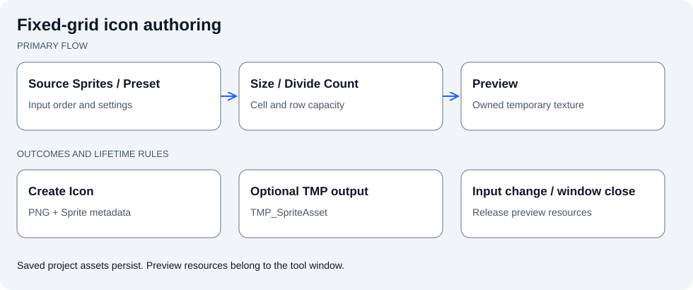

# Jeomseon Unity Editor Toolkit

[한국어](README.md) | English

Provides shared Editor APIs and standalone authoring tools. IconCreator turns individual Sprites into a grid texture and TMP SpriteAsset.



Create a grid texture and optional TMP metadata from source icons. Regenerate the preview after changing inputs.

## Quick start

Open Jeomseon/Icon Creator, set source Sprites/size/Divide Count or load a Preset, Preview, then Create Icon. Other utilities live under Jeomseon/Tool.

1. Open `Jeomseon/Icon Creator`.
2. Load the imported sample Preset or set source Sprites, Size, and Divide Count.
3. Preview the grid, then Create Icon to save the atlas; enable TMP output in the Preset when needed.

## Contracts and limitations

This differs from runtime SpriteAtlas packing. Reference Editor APIs only from Editor assemblies. The tool owns preview resources; regenerate the preview after input changes.

## Requirements

- Unity `6000.6.0f1`
- Package: `com.jeomseon.unity.editor-toolkit` `0.7.3`
- `com.jeomseon.unity.core`: `0.3.2`
- `com.unity.2d.sprite`: `1.0.0`
- `com.unity.ugui`: `2.0.0`

## Installation

Merge this into your project's `Packages/manifest.json`; preserve existing dependencies and registries.

```json
{
  "scopedRegistries": [
    {
      "name": "OpenUPM",
      "url": "https://package.openupm.com",
      "scopes": [
        "com.jeomseon"
      ]
    }
  ],
  "dependencies": {
    "com.jeomseon.unity.editor-toolkit": "0.7.3"
  }
}
```

Or use **Install package from git URL** in Package Manager:

```text
https://github.com/jeomseon0516/Unity.EditorToolkit.git#v0.7.3
```

## Design and behavior

Shared APIs cover EditorWindows, SerializedProperty access, and type discovery. General Inspector
attributes/drawers belong to Attributes. Feature Editors depend on these APIs in one direction;
Runtime assemblies must not use UnityEditor APIs.

### IconCreator

Open Jeomseon/Icon Creator, load a Preset or set Size/Divide Count/source Sprites, Preview, then
Create Icon to save a PNG and Sprite metadata inside the project. Enable GenerateTmpSpriteAsset
in the Preset to also create a TMP SpriteAsset.

Size is cell size; Divide Count is the maximum cells per row. Actual output can be smaller for fewer
inputs; inspect the Preview. Null Sprites/over-capacity input are invalid. Editing input invalidates
the Preview. The window owns preview textures and releases them on recreation/close; saved assets
belong to the project.

SpriteAtlas optimizes runtime/build packing; this tool authors a fixed grid and TMP metadata.
Use the [sample Preset and four-color Sprites](Samples~/BasicUsage/README.md) to verify output.

### Shared APIs

| Area | API | Contract |
| --- | --- | --- |
| Serialized values | `SerializedPropertyExtensions` | Choose accessors for the Unity serialized type |
| Enum metadata | `SerializedEnumData` / `GetEnumData` | Distinguish indices from actual values |
| Discovery | `EditorTypeDiscovery` | Editor TypeCache-based |
| Object graphs | `SerializedObjectGraphTraversal` | Respect Unity/managed reference boundaries |
| UI composition | `EditorDropdownController<T>`, `EditorGUILayoutActions` | Consumer owns callback/temporary-resource lifetimes |
| ScriptableObjects | `ScriptableObjectHandler` | Check asset paths, Undo, and project mutations |

Read [IconCreator](Editor/Tool/IconCreator.cs), [Preset](Editor/Tool/IconCreatorPreset.cs), then
[SerializedProperty helpers](Editor/Extensions/SerializedPropertyExtensions.cs). UI Anchor Setter,
Object Naming Changer, and Bulk Component Remover change project objects; verify selection and Undo.
The sample EditorWindow demonstrates the basic shared API behavior.

## API usage and details

### Icon Creator

`IconCreator` (`Jeomseon/Icon Creator`) combines several individual icon sprites into a
fixed-grid texture and, from that, generates a TextMeshPro `TMP_SpriteAsset` (for inline
sprites). Unity's Sprite Atlas system (`com.unity.2d.sprite`) is a separate optimization
tool that automatically packs scattered sprites at build/runtime to reduce draw calls; it
has no notion of fixed-grid layout and does not produce a `TMP_SpriteAsset`. TextMeshPro's
own Sprite Asset Creator likewise assumes an atlas and sprite metadata already exist, so
neither Unity nor TMP automates the step of combining N loose source icons into a grid.
`IconCreatorPreset` (a `ScriptableObject`) lets you save and reuse the size, divide count,
and default icon list. `Samples~/BasicUsage` includes 4 verification sample sprites and a
matching preset.

### SerializedProperty utilities

`SerializedPropertyExtensions.GetPropertyValue()` returns most property values through
`SerializedProperty.boxedValue`. Types with `boxedValue` limitations, such as `LayerMask`,
`AnimationCurve`, `Gradient`, and array metadata, use their dedicated accessors.

Enum properties are returned as `SerializedEnumData`, preserving `EnumType`, `Value`,
`Index`, `Name`, and `DisplayName`. Use `SerializedPropertyExtensions.GetEnumData()` when
enum metadata is needed directly.

Shared editor APIs, editor windows, and ScriptableObject authoring tools.

Feature-independent inspector attribute declarations and their editor implementations
belong to `com.jeomseon.unity.attributes`. Feature-specific attributes and drawers
belong to their feature packages.

## Verify the behavior

1. Import Basic Usage and Load its Preset in `Jeomseon/Icon Creator`.
2. Check the four colored Sprites, their order, Size, and Divide Count; run Preview.
3. Use Create Icon to save inside the project, then check PNG cell order and Sprite slicing metadata.
4. When GenerateTmpSpriteAsset is enabled, check the generated TMP SpriteAsset character/glyph references. Preview again after changing inputs.

## Samples

Import the desired entry from **Package Manager > Samples**. Use the included Scene/Editor tool and complete its Setup step first, if required.

- [Basic Usage](Samples~/BasicUsage/README.md)

## Further reading

[Complete source map and package metadata](Documentation~/Overview.en.md)
- [Changelog](CHANGELOG.md)

## License

[License](LICENSE.md)
